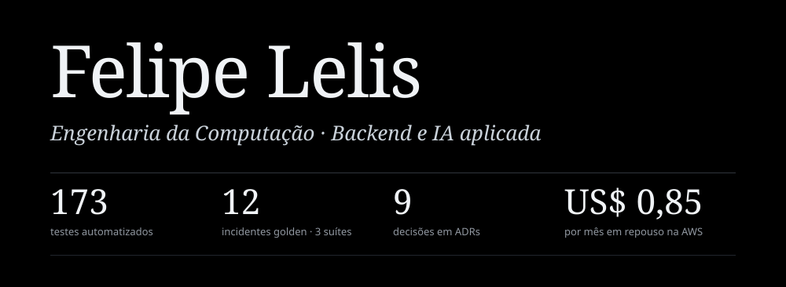

3º ano na UNISAGRADO · Bauru, SP · aberto a remoto · buscando estágio ou júnior

Construo sistemas de IA que se podem testar: agentes que pedem aprovação antes de agir, com custo e comportamento medidos.

<br>

## Projeto principal

### [incident-copilot](https://github.com/lellisz/incident-copilot)

Agente em LangGraph para resposta a incidentes. Recebe um alerta, recupera runbooks com RAG híbrido, investiga com ferramentas somente leitura, propõe um plano de remediação com rollback em cada passo e para para aprovação humana antes de executar qualquer coisa. Os números do topo da página são deste projeto.

```text
triage → retrieve → hypothesize → investigate → propose_remediation → human_approval → execute → postmortem
```

**Custo como restrição de projeto.** Cada chamada começa no modelo mais barato (Hermes 3 local, depois Gemini Flash e Pro) e só escala se o resultado for ruim. Claude Sonnet no Bedrock só entra na proposta de remediação, com teto de orçamento.

**Deploy e qualidade.** Roda na AWS sob demanda (ECS Fargate com PostgreSQL) e tem CI com GitHub Actions.

**Limites declarados.** Ações são simuladas por padrão, a checagem de orçamento ainda não é atômica e não há entrada automática de alertas. Detalhes no README do projeto.

<br>

## Competências

| | |
| :-- | :-- |
| **Backend** | Python · SQL · PostgreSQL (pgvector) · Pydantic · APIs REST · C |
| **Cloud e DevOps** | AWS (Bedrock, ECS Fargate, S3, IAM, CloudWatch, Secrets Manager) · Docker · GitHub Actions |
| **IA** | LangGraph · LangChain · RAG híbrido · sistemas multiagente · integração de LLMs por API |

<br>

## Formação e certificações

- **Engenharia da Computação**, UNISAGRADO (2023 a 2028)
- **AWS Certified AI Practitioner (AIF-C01)**, concluída em outubro de 2026
- **Anthropic Academy:** Claude Code e Claude Platform
- **CS50:** Web e IA
- **Em andamento:** curso de ML e IA do GCI

Inglês avançado, com leitura técnica fluente.

<br>

## Contato

[LinkedIn](https://linkedin.com/in/felipe-lelis-752790375) · [GitHub](https://github.com/lellisz)

<sub>"Every genuine test of a theory is an attempt to falsify it." — Karl Popper</sub>
